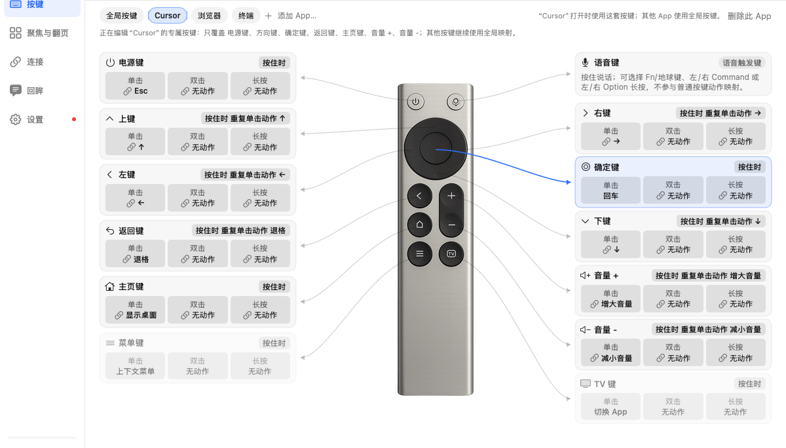
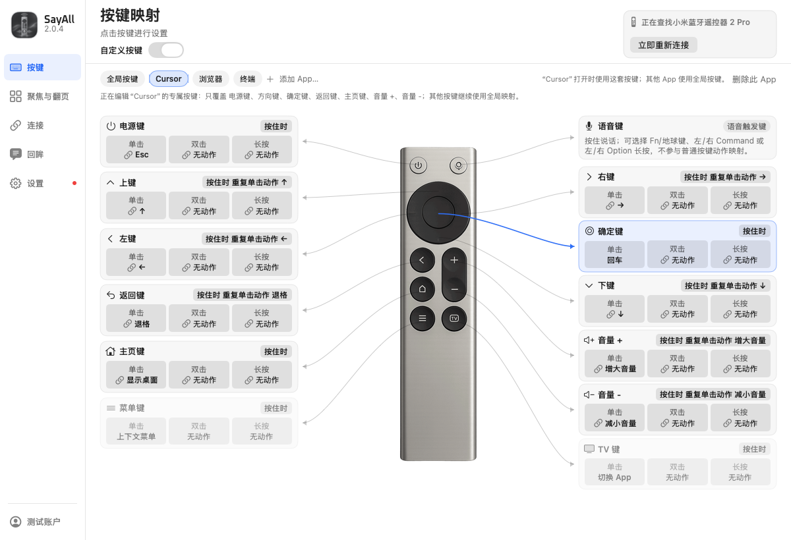

# 遥麦 · 让小米蓝牙遥控器 2 Pro 一个键干一件事

> 同一颗按键，在 Cursor 里是"说完就发"，在浏览器里是"刷新页面"，在剪辑软件里是"往后跳一帧"。

遥麦是 macOS 上给**小米蓝牙遥控器 2 Pro（型号 RC003）**和**小米蓝牙遥控器 2（RC001）**用的按键方案：把遥控器连上 Mac，按住语音键说话，文字直接进当前窗口；再给每个 App 单独设一套按键，谁在前台，按键就听谁的。

名字取自"遥控器"的「遥」和"麦克风"的「麦」。它是开源项目 [SayAll](https://github.com/HD838A/remote-mic-app) 的修改版，在它之上主要新增了两件事：**按前台 App 分别设置按键**，以及**一个能与官方版同时安装、互不干扰的开发版构建**；其余蓝牙连接、语音输入、手势等能力直接来自上游。

## 这是什么？（第一次听说的人看这段）

小米蓝牙遥控器本来是看电视用的：蓝牙连接、自带麦克风、有一颗独立的语音键。后来大家发现它特别适合当 AI 的"语音手柄"——按住语音键说需求，AI 那边就直接收到文字，手不用离开遥控器。这个用法在 Cursor、Claude Code、Codex 这类工具上尤其顺手，也就是大家说的 vibe coding（氛围编程）。

让遥控器在 Mac 上跑起来的开源软件是 SayAll。**遥麦 在它的基础上多做了一件事：按键可以按 App 分开设。**



截图里顶部那排「全局按键 / Cursor / 浏览器 / 终端」就是新加的东西：点某个 App，下面改的只有那个 App 的按键，其余保持一致。

## 为什么要分 App

因为一台遥控器在不同软件里的角色完全不一样：

| 你在做什么 | 你希望按键做什么 |
|---|---|
| 写代码 | 语音键说话，确认键发送 |
| 浏览网页 | 方向键翻页，返回键后退 |
| 剪辑、设计 | 方向键微调，长按加速 |
| 开会 | 一键静音，切到会议窗口 |

官方公开版只有一套全局按键。遥麦 让你只改想改的键，其余继续继承全局——不用为每个 App 复制一整张表。

## 功能

### 一个 App 一套键位

- 稀疏存储：只记住你显式改过的「按键 + 触发方式」，没动过的走全局。
- 显式设成「禁用」的键不会回落到全局——"在这个 App 里这个键什么都不做"也是需求。
- 编辑某个 App 时，页面会明确写出这次只覆盖哪些键，其余继续用全局映射。
- 导入配置时会校验这份映射，不合法整份拒绝；完整配置备份也包含它。



### 手势不会串味

- **按下瞬间记录前台 App，整个手势沿用同一份映射**：单击、双击、长按、按住、重复、松开都算同一次手势。按住不放时切到别的 App，松开仍按当初那套执行。
- 展示、手势判定、按住连发、原生透传都用同一个解析结果，不会"显示一个键、执行另一个键"。

### 开发版可以和官方版并存

- 独立的单实例锁、数据目录、日志目录、诊断目录，不抢锁、不写坏数据。
- 开发版不带更新 feed、关掉自动更新，不会被官方版本顶掉。
- 一条命令完成构建、改身份、校验、递增构建号、替换旧版本、启动。

### 底座能力

蓝牙连接（小米 RC001 / RC003）、语音输入与虚拟麦克风、双击/长按/按住连发、组合动作、常用语、使用统计与回眸、加密诊断日志、Sparkle 更新——这些来自上游，遥麦 一并具备，改的只是按键归属这一层。

## 我的遥控器能用吗

| 遥控器 | 型号 | 支持 |
|---|---|---|
| 小米蓝牙遥控器 2 Pro | RC003 | ✅ 主要目标机型 |
| 小米蓝牙遥控器 2 | RC001 | ✅ |

遥控器改完按键后仍然是电视遥控器，不影响原来的用途。

## 开始之前要准备什么

- Apple Silicon Mac（macOS 14+）或 Intel Mac（macOS 13+）。
- 小米蓝牙遥控器 2 / 2 Pro，已完成蓝牙配对。
- 一个虚拟麦克风（官方安装包会带，或自备 BlackHole 2ch），语音工具里要选它作为输入。
- 输入监控、辅助功能权限——第一次使用时系统会弹窗，跟着点允许即可。

## 适合谁

- 手上有小米蓝牙遥控器 2 Pro / 2，想把它当 Mac 语音手柄的人。
- 日常在几个固定软件之间切换，希望同一个键在不同 App 干不同事的人。
- 愿意自己编译、或者想在自己机器上同时跑开发版和官方版的人。

## 不适合谁

- **完全不想折腾电脑设置的普通用户**：请直接用官方 SayAll，它已经把"连上就能说话"做好了；遥麦 目前只有源码，没有安装包。
- 需要多套方案手动切换、方案库管理的人：遥麦 只有「全局 + 每个 App」两层。
- 用 Windows 的人：这是 macOS 客户端，Windows 版是另一个项目。

## 自己构建

需要 macOS 和 Swift 6.2 工具链（Xcode 或 Command Line Tools）。

```bash
swift build --disable-keychain
```

编译。自测：

```bash
scripts/test.sh
```

自带的自测（`Tests/SelfTest`），不依赖 Xcode 的 Testing 框架，48 项全过才算好。

装成一个独立的开发版：

```bash
scripts/package-dev-app.sh
```

默认 bundle id `com.hehf.SayAllDev`、显示名 `遥麦`，装在 `~/Applications/遥麦.app`，装完自动启动。加 `SAYALL_DEV_DEFER_LAUNCH=1` 只装不启动；想换身份就设 `SAYALL_DEV_BUNDLE_IDENTIFIER` / `SAYALL_DEV_DISPLAY_NAME`。

`Tests/RemoteMicTests` 用的是 Swift Testing，需要完整 Xcode：`swift test --disable-keychain`。

## 和官方版的关系

遥麦 是独立的修改版，不是官方发行版，也没有官方背书。

"按前台 App 分键位"在官方版本里由私有的 `SayAllButtonProfiles` 组件提供，公开构建拿不到，所以官方公开版只有全局按键。遥麦 用公开代码把这块重新实现了一遍：不解锁会员、不包含私有组件、不绕过任何授权。如果哪天官方把这项能力开放到公开构建，请优先用官方的。

## 跟上上游

仓库保留了完整的上游历史，`upstream` 远端指向官方：

```bash
git fetch upstream
git merge upstream/main
```

冲突热点集中在 `AppSettings.swift`、`SettingsView.swift`、`HIDRemoteMonitor.swift`、`BridgeAppModel.swift`，合并后建议跑一遍 `scripts/test.sh` 再真机冒烟。

## 来源、许可与边界

- 上游项目：[HD838A/remote-mic-app](https://github.com/HD838A/remote-mic-app)，`GPL-3.0-only`。遥麦 是它的衍生作品，同样以 `GPL-3.0-only` 发布，全文见 [LICENSE.md](LICENSE.md)；上游版权与第三方来源见 [COPYRIGHT.md](COPYRIGHT.md)、[THIRD_PARTY_NOTICES.md](THIRD_PARTY_NOTICES.md)。
- **我改了什么**：从上游最新提交起有两个提交——一个加按 App 键位，一个加可共存的开发版身份；改动日期 2026-11。完整 diff 可以直接和 `upstream/main` 对比。
- **图标**：本仓库的 App 图标是我自己画的，不属于上游 [LOGO-LICENSE.md](LOGO-LICENSE.md) 的授权范围，仓库里不包含官方 Logo 文件。
- **名字**：`遥麦` 是这个修改版的名字，只表示改造自 SayAll，不代表官方。
- 截图来自开发版设置页的离屏渲染，用于说明界面结构；实际使用前需要在按键页打开「自定义按键」。
- 不保证可用、不提供支持、不承诺跟进上游更新，请勿用于商业分发。

## 致谢

蓝牙、音频、HID、手势、发布流程这些底座都是上游作者和贡献者做的，我只是在公开代码上补了自己需要的一个维度。

开发文档入口：[DOCUMENTATION.md](DOCUMENTATION.md)

---

hehf · 有问题请开 [Issue](https://github.com/hehuifeng/yaomai/issues)
